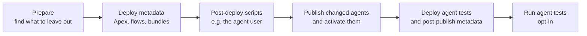

# Agentforce

The kit treats Agentforce agents like any other part of a Salesforce project. If your source holds agents or agent tests, the reusable workflows bring them to the target org. If it holds none, these steps skip themselves and nothing changes.

| You want to                     | Workflow                                                                                     | Input                              | Default |
| ------------------------------- | -------------------------------------------------------------------------------------------- | ---------------------------------- | ------- |
| Compile Agent Script on a PR    | [`pr-validation.yml`](/workflows/pr-validation)                                              | `validate-agents`                  | on      |
| Publish and activate agents     | [`deployment.yml`](/workflows/deployment), the scratch org workflows                         | `deploy-agents`, `activate-agents` | on      |
| Run agent tests against the org | [`deployment.yml`](/workflows/deployment), [`scratch-org-ci.yml`](/workflows/scratch-org-ci) | `agent-tests`, `agent-test-names`  | **off** |

Agent tests are opt-in because Salesforce warns that they [consume requests and credits and can change CRM data](https://help.salesforce.com/s/articleView?id=ai.agent_testing_center.htm&type=5&language=en_US). Salesforce recommends running them in a sandbox.

## What the pipeline does

A plain `sf project deploy` is not enough for an agent, so the steps run in this order:



Each step exists for a reason:

- **Metadata first.** Publishing does not deploy the Apex classes and flows behind an agent's actions.
- **Tests last.** A test definition fails the whole deployment with `BotVersion not found` while its agent has no version in the org.
- **Publish only what changed.** Every publish creates a new agent version, even without a change. The pipeline compares your Agent Script with the latest published version in the org and only publishes a difference, so a pipeline running on every push doesn't pile up versions.
- **Active versions stay out.** Deploying an active version fails with `Can't edit an active bot version`, even if it is unchanged. Versions are immutable, so the pipeline leaves it out.

The version activated is always the one matching your source. If somebody activated another version in the org by hand, the next run switches back.

On a dry-run and in PR validation, the pipeline only compiles the Agent Script. Nothing is published or activated, and test definitions stay out.

## Set up your project

### 1. Keep the authoring bundle in Git

[Salesforce recommends](https://developer.salesforce.com/blogs/2026/05/new-agentforce-metadata-and-development-lifecycle) keeping just the `AiAuthoringBundle` in source control for most pipelines. That is the best-supported path here too, and each org then counts its own versions.

Two formats are recognized:

| In your source                                                                     | What the pipeline does                                                                                                                                     |
| ---------------------------------------------------------------------------------- | ---------------------------------------------------------------------------------------------------------------------------------------------------------- |
| **Draft bundle** - an authoring bundle without `<target>`                          | Publishes and activates it. Compiled files of the same agent are left out of the deployment, as their versions belong to the org they were retrieved from. |
| **Compiled metadata** - `AiAgentDefinition` or `Bot` files, without a draft bundle | Deploys them without the active version, then activates the highest version in your source.                                                                |

An agent built with Agent Script can only be deployed as compiled metadata together with its bundle, including a `<target>`. A publish expects the bundle in the default package directory of `sfdx-project.json`.

### 2. Use API version 68.0

Set `"sourceApiVersion": "68.0"` in `sfdx-project.json`. The `AiAgentDefinition` and `AiAgentDefinitionVersion` types [need API version 68](https://developer.salesforce.com/docs/ai/agentforce/guide/agent-dx-deploy-metadata.html). With an older version, a deployment that contains them fails with `Not available for deploy for this API version`.

### 3. Extend the connected app

Add the OAuth scopes `chatbot_api`, `sfap_api` and `web` to the connected app of your [JWT login](authentication.md), next to `api` and `refresh_token`. The Salesforce CLI needs them to reach the agent APIs.

Each target org needs Einstein and Agentforce enabled, and the integration user needs the [permissions to publish agents](https://developer.salesforce.com/docs/ai/agentforce/guide/agent-dx-deploy-metadata.html). A scratch org definition has to enable Agentforce as well:

```json
{
  "features": ["Einstein1AIPlatform"],
  "settings": {
    "einsteinGptSettings": { "enableEinsteinGptPlatform": true },
    "agentPlatformSettings": { "enableAgentPlatform": true }
  }
}
```

### 4. Handle what differs between orgs

A service agent names its agent user in the script (`default_agent_user`), and that username is different in every org. Use a [string replacement](https://developer.salesforce.com/docs/ai/agentforce/guide/agent-dx-deploy-metadata.html) in `sfdx-project.json`, which `sf agent publish` applies as well:

```json
{
  "replacements": [
    {
      "glob": "force-app/**/*.agent",
      "stringToReplace": "%%AGENT_USERNAME%%",
      "replaceWithEnv": "SF_AGENT_USERNAME"
    }
  ]
}
```

The reusable workflows pass the variable `SF_AGENT_USERNAME` to the CLI. Set it as an environment variable under **Settings → Environments**, one value per org. A change of the value counts as a change of the script and publishes a new version.

The agent user has to exist before the publish. Create it with a [post-deploy script](/workflows/deployment), for example, as those run first.

### 5. Deploy what references an agent afterwards

A permission set that grants access to an agent can't be deployed before the agent exists. Keep it outside of `source-dir` and name its directory in `agent-post-publish-dir`:

```yaml
with:
  source-dir: force-app
  agent-post-publish-dir: agent-access
```

### 6. Write tests for every org

Leave out `subjectVersion` in your test definitions. Without it, a test runs against the active version, while a version number means something else in each org. The pipeline warns about a pinned version.

`sf agent test run` returns exit code `0` for failed expectations, so a pipeline that only checks the exit code stays green. [`sfdx-run-tests`](https://github.com/svierk/sfdx-run-tests) reads the result of every test case instead. Failed expectations, test cases ending with an error, runs without a result and runs exceeding `wait` all fail the step. Agents answer differently from run to run, so prefer expectations that tolerate this.

## Building blocks

To compose your own pipeline, call [`sfdx-agent-deploy`](https://github.com/svierk/sfdx-agent-deploy) twice around [`sfdx-deploy`](https://github.com/svierk/sfdx-deploy):

```yaml
- name: Prepare Agents
  id: agents
  uses: svierk/sfdx-agent-deploy@v1.0.0
  with:
    phase: prepare
    source-dir: force-app
    target-org: ci

- name: Deploy Metadata
  uses: svierk/sfdx-deploy@v1.4.0
  with:
    source-dir: force-app
    exclude: ${{ steps.agents.outputs.exclude }}
    target-org: ci

- name: Deploy Agents
  uses: svierk/sfdx-agent-deploy@v1.0.0
  with:
    source-dir: force-app
    target-org: ci

- name: Run Agent Tests
  uses: svierk/sfdx-run-tests@v1.4.0
  with:
    apex: false
    agent: true
    target-org: ci
```

## Limits

- **Deleting an agent:** removing an agent from Git does not remove it from the org. Deactivate and delete it there.
- **Versions across orgs:** Salesforce [blocks later deployments](https://developer.salesforce.com/docs/ai/agentforce/guide/agent-dx-deploy-metadata.html) of compiled metadata when the orgs hold different versions, so create new versions in one org and promote them from there. A draft bundle doesn't have this limit.
- **`replaceWithFile`:** a script using this kind of replacement can't be compared with the org, so it is published on every run.
- **Agentforce Studio tests (beta):** `AiTestingDefinition` tests run through the same step, but this beta can't create such a test in every org yet.
