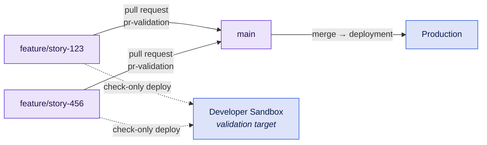

# B1 - Simple Org Development

The default starting point. One team, one production org, one branch that is always deployable.

## At a glance

|                   |                                                                               |
| ----------------- | ----------------------------------------------------------------------------- |
| **Team size**     | 1-6 developers and admins                                                     |
| **Environments**  | 1 developer sandbox + production                                              |
| **Branch model**  | GitHub Flow - `main` plus short-lived `feature/*`                             |
| **Cadence**       | Continuous, deploy on merge                                                   |
| **Maturity**      | Level 1-2                                                                     |
| **Prerequisites** | A Dev Hub only if you add scratch org CI; otherwise a single integration user |

## Target picture



## Org & sandbox landscape

- **One Developer sandbox** as the validation target. Pull requests deploy into it check-only, so it never actually changes - which means it does not need refreshing on a schedule and one sandbox serves the whole team.
- **Production** as the only deployment target.
- Individual developers may have their own Developer sandboxes or scratch orgs for building. That is a local preference, not part of the pipeline.

No Full or Partial Copy sandbox is required, so this blueprint runs inside a standard Enterprise Edition entitlement with no add-on.

## Branch model

- `main` is always deployable and is the only long-lived branch.
- `feature/*` branches are short-lived - hours to a few days. Anything longer means the change should have been split or feature-flagged.
- Merge by pull request only, squash or merge commit as you prefer.
- No `develop`, no release branches. If you feel you need one, read [B2](b2-multi-team-release-branches.md) before adding it.

## Promotion path & roles

| Role              | Does                                                                               |
| ----------------- | ---------------------------------------------------------------------------------- |
| Developer / admin | Builds in a sandbox or scratch org, commits to `feature/*`, opens the pull request |
| Reviewer          | Reviews the diff, checks that the validation run is green                          |
| Whoever merges    | Merging to `main` deploys to production - so the merge _is_ the release decision   |

Declarative changes need an explicit owner: someone has to retrieve them from the sandbox into a feature branch. In a team this size that is usually the person who built them, assisted by the CLI or an IDE - name them, or the change will reach production by hand.

## Strengths

- The least ceremony of any model here. Nothing to explain to a new joiner beyond "branch, PR, merge".
- No long-lived branch pairs to keep in sync, so essentially no XML merge conflicts on profiles or flows.
- Fast lead time: commit to production in one hop.

## Trade-offs & anti-patterns

- **Nothing sits between merge and production.** Your safety has to come from the validation gate and from a protected production environment, not from a staging branch. Configure both.
- **No natural place to freeze scope.** If you need to hold a set of changes back for a coordinated launch, use feature flags or simply do not merge - do not invent a release branch as a workaround.
- **Long-lived feature branches defeat the model.** A branch open for three weeks accumulates exactly the conflicts this model is designed to avoid.
- **Hotfixes have no special path**, and do not need one: a hotfix is just a short feature branch.

## Kit mapping

**Pull request validation** - [`pr-validation.yml`](/workflows/pr-validation) on every pull request into `main`, as a required status check. Delta validation is on by default, so only changed components are checked:

```yaml
name: PR Validation

on:
  pull_request:
    branches: [main]

permissions:
  contents: read
  security-events: write

jobs:
  validate:
    uses: svierk/salesforce-devops-starter-kit/.github/workflows/pr-validation.yml@v1.1.0
    with:
      source-dir: force-app
      test-level: RunLocalTests
    secrets:
      SFDX_CONSUMER_KEY: ${{ secrets.SFDX_CONSUMER_KEY }}
      SFDX_JWT_SECRET_KEY: ${{ secrets.SFDX_JWT_SECRET_KEY }}
      SFDX_USERNAME: ${{ secrets.SFDX_USERNAME }}
```

**Production deployment** - [`deployment.yml`](/workflows/deployment) on push to `main`, gated by a GitHub Environment so a human still approves the release:

```yaml
name: Deploy to Production

on:
  push:
    branches: [main]

permissions:
  contents: read

jobs:
  deploy:
    uses: svierk/salesforce-devops-starter-kit/.github/workflows/deployment.yml@v1.1.0
    with:
      source-dir: force-app
      target-org-alias: production
      test-level: RunLocalTests
      environment: production # required reviewers + environment-scoped secrets
    secrets:
      SFDX_CONSUMER_KEY: ${{ secrets.SFDX_CONSUMER_KEY }}
      SFDX_JWT_SECRET_KEY: ${{ secrets.SFDX_JWT_SECRET_KEY }}
      SFDX_USERNAME: ${{ secrets.SFDX_USERNAME }}
```

**Branch protection on `main`:**

- Require a pull request before merging, with at least one approval
- Require the PR Validation check to pass
- Require branches to be up to date before merging
- Block force pushes and deletions

**Optional additions:**

- [`scratch-org-ci.yml`](/workflows/scratch-org-ci) on feature branches for a clean-org test run - the cheapest way to catch "works in my sandbox" problems.
- [`create-scratch-org.yml`](/workflows/create-scratch-org) so anyone can provision a ready-to-use org from the Actions tab without a local CLI.

## Migration path

**To [B2](b2-multi-team-release-branches.md)** when a second stream appears and you start holding merges back to avoid shipping someone else's half-finished work, or when a stakeholder needs a stage to sign off in before production.

**To [B3](b3-package-based-modular.md)** directly, skipping B2, if your metadata is already modular and you would rather invest in packaging than in stages. This is the better move if the pressure is "teams block each other" rather than "we need an approval gate".

**Signals to watch:** rising change failure rate, pull requests waiting on each other, or the phrase "let's not merge that yet" becoming routine.
