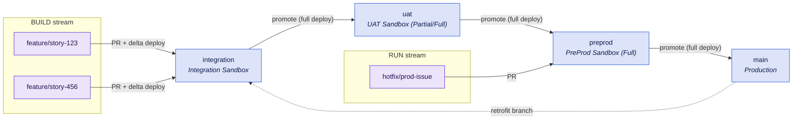
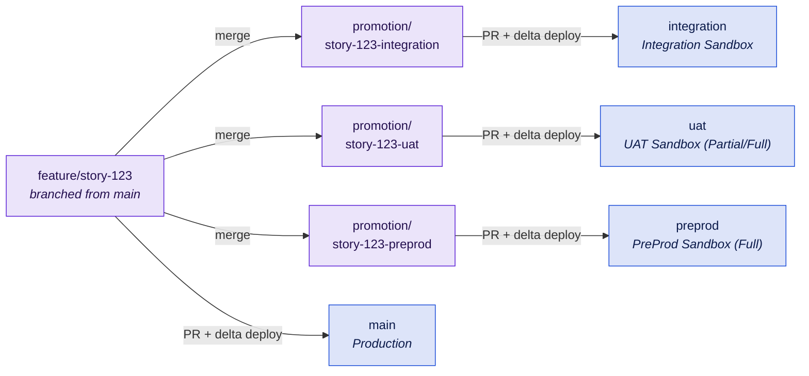

# B2 - Multi-Team with Environment Branches

Several streams, one long-lived Git branch per org, and an explicit release decision. The classic enterprise Salesforce setup - and the one that costs the most to operate, so adopt it only for the stages your approval process actually requires.

The environment branches are the same either way. What differs is **what travels between them**, and that follows from [how you release](questions.md#_5-how-do-you-release):

- **[Release train](#release-train)** - the whole state of a branch moves up the chain, stage by stage, on planned release dates. It is the default model of the open-source [sfdx-hardis](https://sfdx-hardis.cloudity.com/salesforce-devops-deploy-major-branches/).
- **[Story promotion](#story-promotion)** - every user story travels on its own, into each stage through a short-lived promotion branch, and reaches production when it is ready. [Gearset Pipelines](https://docs.gearset.com/en/articles/6115722-the-gearset-pipelines-branching-model) implements it almost exactly; Copado and DevOps Center follow the same principle with different mechanics. Here it runs on plain GitHub and the kit's workflows.

## At a glance

|                   |                                                                                    |
| ----------------- | ---------------------------------------------------------------------------------- |
| **Team size**     | 5-25 developers and admins across several streams                                  |
| **Environments**  | Integration + UAT + pre-production + production                                    |
| **Branch model**  | Four environment branches: `integration`, `uat`, `preprod`, `main`                 |
| **Release style** | Release train: planned release dates · Story promotion: continuous, story by story |
| **Maturity**      | Level 2-3 - at level 1, start with two stages (see below)                          |
| **Prerequisites** | Sandbox budget - see the licence warning below                                     |

## Two ways to promote

|                            | Release train                                   | Story promotion                                                 |
| -------------------------- | ----------------------------------------------- | --------------------------------------------------------------- |
| What moves                 | The whole state of a branch                     | One user story, separately into each stage                      |
| Feature branches start at  | `integration`                                   | `main` - the production state                                   |
| Stage-to-stage merges      | Yes, strictly up the chain                      | Never - environment branches are not merged into each other     |
| Deployment between stages  | Full                                            | Delta - only what the story brought                             |
| A story that is not ready  | Holds the train, or has to be backed out        | Holds only itself                                               |
| Where conflicts are solved | In the target branch, once per hop              | In the story's promotion branch, once per stage                 |
| Urgent fixes               | Separate hotfix path with a hard constraint     | A story like any other, promoted only as far as it needs        |
| Fits                       | Planned release dates, scope frozen per release | Continuous delivery of independent stories, with approval gates |

If you ship on release dates, run the train. If stories should reach production as soon as they are signed off, run story promotion. Switching later does not touch the orgs or the environment branches - only how changes travel between them.

## Target picture

### Release train



### Story promotion



## Org & sandbox landscape

One sandbox per environment branch:

| Branch        | Org            | Sandbox type         | Why                                                    |
| ------------- | -------------- | -------------------- | ------------------------------------------------------ |
| `integration` | Integration    | Developer Pro        | Where streams collide first; metadata only is enough   |
| `uat`         | UAT            | Partial Copy or Full | Business sign-off needs realistic data                 |
| `preprod`     | Pre-production | Full                 | Last rehearsal - as close to production as you can get |
| `main`        | Production     | -                    | -                                                      |

Plus Developer sandboxes or scratch orgs per developer for building.

::: tip Starting out? Begin with two stages
At maturity level 1, four long-lived branches collapse under their own weight. Start with `uat` and `main` only - the pull request into `uat` is where streams collide, and the UAT sign-off is your gate. Add `integration` once CI runs on every pull request, and `preprod` only when a release rehearsal on production-like data is genuinely required.
:::

::: warning This is the expensive blueprint
On Enterprise Edition, Full and Developer Pro sandboxes are a paid add-on. Before committing to four stages, price the entitlement - and ask whether UAT on a Partial Copy would be enough, which is often the case. A stage nobody signs off in is pure overhead. See [Dimensions](dimensions.md#sandbox-types).
:::

Remember the refresh intervals: a Full sandbox can only be refreshed every 29 days, so `preprod` drifts from production between refreshes. Schedule the refresh, and treat "it worked in preprod" as evidence, not proof.

## Branch model

**Environment branches** are long-lived, protected, and each bound to one org: `integration`, `uat`, `preprod`, `main`. Each one describes what its org should contain.

**Short-lived branches** carry the work and are deleted once merged. Which ones you use depends on the variant.

### Release train

`feature/*` and `hotfix/*` are the short-lived branches. Make `integration` the repository's default branch - it is where feature work targets.

**Merge direction is strictly one way**, up the chain. Deployment mode differs by hop:

- **Feature → environment** (`feature/*` → `integration`): **delta** deployment. Only what the branch changed.
- **Environment → environment** (`integration` → `uat` → …): **full** deployment. The promoted state is the whole branch, and a delta here would silently skip anything a previous hop missed.

Two streams share the chain:

- **BUILD** - normal features, entering at `integration` and traversing all four stages.
- **RUN** - urgent fixes, entering at `preprod` and reaching `main` in two hops.

::: danger The RUN stream has a hard constraint
While a release is being validated in `preprod`, the RUN stream cannot deploy to production without shipping that unvalidated release with it. Either your pre-production validation window is short, or your hotfix path is blocked for its duration. Decide which, in advance, and write it down.
:::

After a hotfix reaches `main`, **retrofit** it back into the BUILD stream: branch from `main`, open a pull request into `integration`. Do this immediately - a retrofit deferred by a week is a merge conflict on a flow you no longer remember. Where retrofits are routine, a Salesforce-aware merge driver is worth the setup.

### Story promotion

`feature/*` branches start from **`main`**, so a story carries the production state plus its own change - nothing that is still in flight in a lower stage. Keep `main` as the default branch.

Environment branches are **never merged into each other**. A story reaches each stage on its own:

1. Create a promotion branch from the target environment branch, e.g. `promotion/story-123-uat` from `uat`.
2. Merge the feature branch into it. Resolve conflicts **here**, so the feature branch stays clean for the next stage.
3. Open a pull request into the environment branch. Once merged, the stage deploys the delta - exactly what the merge brought in.
4. Delete the promotion branch.

```bash
git switch -c promotion/story-123-uat origin/uat
git merge --no-ff origin/feature/story-123   # resolve conflicts on this branch
git push -u origin promotion/story-123-uat
gh pr create --base uat --title "Promote story-123 to uat"
```

To production, the feature branch itself goes into `main` - through a promotion branch only if it conflicts. An urgent fix is simply a story that is promoted only as far as it has to go, typically `uat` and then `main`, without waiting for anything else.

**Sync after every release.** Each stage holds a different set of stories, so the environment branches drift apart by design. After each production deployment, merge `main` back into every environment branch through a pull request. It keeps each stage at "production plus the stories in flight", and it stops the same conflict from coming back at every stage.

## Promotion path & roles

| Role            | Release train                                                                              | Story promotion                                                           |
| --------------- | ------------------------------------------------------------------------------------------ | ------------------------------------------------------------------------- |
| Developer       | Builds in a dev sandbox, commits to `feature/*`, opens a PR into `integration`             | Builds, then promotes the story into `integration` and the test stages    |
| Tech lead       | Reviews PRs into `integration`, keeps the branch green                                     | Reviews the story's first promotion and its PR into `main`                |
| Release manager | Owns the stage-to-stage promotions, decides what enters the train, runs the approval gates | Decides which stories enter `preprod` and `main`, runs the approval gates |
| Business owner  | Signs off in UAT - the gate that justifies the stage existing                              | Signs off each story in UAT                                               |

Grant merge rights on `uat`, `preprod` and `main` to the release manager role only. `integration` stays open to the team - that is the point of having it.

## Strengths

- Clear stage gates with a named owner per gate.
- Maps onto approval and segregation-of-duties requirements without inventing process.
- **Release train:** conflicts surface in `integration`, early and cheaply, rather than during a release. BUILD and RUN separate cleanly, so an urgent fix does not have to wait for the train.
- **Story promotion:** stories move independently - one that fails UAT holds nobody else back. `main` only ever receives stories, never the leftovers of a lower stage. Urgent fixes need no special path.

## Trade-offs & anti-patterns

- **Four long-lived branches is real, permanent overhead.** Every promotion is a merge, and XML metadata merges badly. This is the cost you are paying for the gates - make sure you are getting them.
- **Do not degrade into branch-per-org as backup.** If promotions stop being reviewed pull requests and become "sync the branch to what is in the org", you have lost the model's only real benefit. See the [warning in Dimensions](dimensions.md#branching-models).
- **Do not add a fifth stage.** If something needs another environment, it usually needs feature flags instead.
- **Drift is the silent failure mode.** Orgs receive changes outside the pipeline; each one makes the next promotion less predictable.
- **Release train: do not test large features directly in `preprod`.** It blocks the RUN stream and skips the UAT gate.
- **Story promotion: what you tested is not byte for byte what you ship.** Each stage resolves its own conflicts, so `uat` and `main` can differ in more than the stories they hold. The sync after every release keeps that gap small; skipping it makes it grow.
- **Story promotion: dependent stories need a rule.** If story B builds on story A, promoting B alone breaks the stage. Track the dependency on the work item, and promote A first.
- **Story promotion: do not promote by hand at scale.** Four promotion branches per story is toil. Automate the steps above, and see the caveat under Kit mapping.

## Kit mapping

**Validation on every environment branch** - [`pr-validation.yml`](/workflows/pr-validation) as a required check for pull requests into all four, with delta validation. In story promotion, these are the pull requests from the promotion branches - each one validates the story merged with that stage's state:

```yaml
name: PR Validation

on:
  pull_request:
    branches: [integration, uat, preprod, main]

permissions:
  contents: read
  security-events: write

jobs:
  validate:
    uses: svierk/salesforce-devops-starter-kit/.github/workflows/pr-validation.yml@v1.1.0
    with:
      source-dir: force-app
      test-level: RunLocalTests
      delta: true
      severity-threshold: '3'
    secrets:
      # Repository secrets: pr-validation does not run inside a GitHub
      # Environment, so every pull request validates against one org
      SFDX_CONSUMER_KEY: ${{ secrets.SFDX_CONSUMER_KEY }}
      SFDX_JWT_SECRET_KEY: ${{ secrets.SFDX_JWT_SECRET_KEY }}
      SFDX_USERNAME: ${{ secrets.SFDX_USERNAME }}
```

**One deployment per environment branch** - [`deployment.yml`](/workflows/deployment), triggered on push, with a GitHub Environment per org. The environment carries both the approval rules and the org's credentials, so the same reusable workflow serves all four stages:

```yaml
name: Deployment

on:
  push:
    branches: [integration, uat, preprod, main]

permissions:
  contents: read

jobs:
  deploy:
    uses: svierk/salesforce-devops-starter-kit/.github/workflows/deployment.yml@v1.1.0
    with:
      source-dir: force-app
      target-org-alias: ${{ github.ref_name }}
      test-level: RunLocalTests
      # Release train: stage-to-stage promotions deploy the full branch state
      delta: false
      # integration | uat | preprod | production - each with its own secrets
      # and, for preprod and production, required reviewers
      environment: ${{ github.ref_name == 'main' && 'production' || github.ref_name }}
    secrets: inherit
```

For **story promotion**, deploy the delta of each merge instead - the story plus any conflict resolution from its promotion branch. `github.event.before` is the state of the environment branch before the push:

```yaml
      delta: true
      delta-from: ${{ github.event.before }}
```

::: tip One secret set per org
Create four GitHub Environments and store `SFDX_CONSUMER_KEY`, `SFDX_JWT_SECRET_KEY` and `SFDX_USERNAME` as environment secrets in each. `secrets: inherit` then resolves the right org automatically, and adding a stage never means editing the caller. Add required reviewers to `preprod` and `production` for the approval gate.

Environment secrets only reach the deployments. The PR validation above reads the repository secrets, so store the credentials of the org you validate against there - typically the integration sandbox.
:::

**Automating story promotion.** The kit has no promotion workflow yet, so the four steps above run in your own workflow or by hand. If you automate them with GitHub Actions, note that a pull request opened with the default `GITHUB_TOKEN` does **not** trigger other workflows - the PR Validation would never run. Open the pull request with a GitHub App token instead.

**Branch protection on all four environment branches:**

- Require a pull request before merging - no direct pushes, including for the release manager
- Require the PR Validation check to pass
- Require branches to be up to date before merging
- Restrict who can merge into `uat`, `preprod` and `main` to the release manager role
- Block force pushes and deletions
- Default branch: `integration` for the release train, `main` for story promotion

**Optional:** [`scratch-org-ci.yml`](/workflows/scratch-org-ci) on `feature/*` pushes as fast CI before the first promotion - it creates a clean org, deploys, tests and deletes it, so a story is tested in isolation before it reaches shared `integration`.

## Migration path

**Between the variants** - in either direction, at any time. The orgs and the environment branches stay; only the way changes travel between them changes. Teams often start on the train and move to story promotion once stories are small and independent enough to ship one by one.

**To [B3](b3-package-based-modular.md)** - the intended destination. Extract the first unlocked package from the happy soup, move its development to scratch orgs, and as packages take over, collapse the stages: `uat` usually goes first, then `preprod`.

**Signals you are ready:** deployment frequency, lead time and change fail rate improving over several quarters, measured against your own baseline, and metadata that has proven separable in practice - not just on a whiteboard.

**Signals you over-built:** a stage where nothing is ever rejected, a UAT sign-off that is a formality, or a promotion chain that takes longer than the development it gates. Remove the stage. Moving back toward [B1](b1-simple-org-development.md) is a legitimate outcome.

**If compliance boundaries or data residency appear** → [B4](b4-multi-org-regional.md), which can run this same model once per production org.
