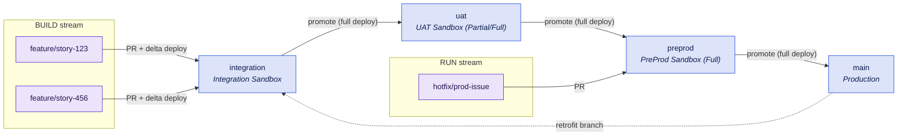

# B2 - Multi-Team with Release Branches

Several streams, a staged promotion chain, and an explicit release decision. The classic enterprise Salesforce setup - and the one that costs the most to operate, so adopt it only for the stages your approval process actually requires.

## At a glance

|                   |                                                             |
| ----------------- | ----------------------------------------------------------- |
| **Team size**     | 5-25 developers and admins across several streams           |
| **Environments**  | Integration + UAT + pre-production + production             |
| **Branch model**  | Promotion chain: `integration` → `uat` → `preprod` → `main` |
| **Cadence**       | Fixed release trains with a separate hotfix path            |
| **Maturity**      | Level 2-3                                                   |
| **Prerequisites** | Sandbox budget - see the licence warning below              |

## Target picture



## Org & sandbox landscape

One sandbox per major branch:

| Branch        | Org            | Sandbox type         | Why                                                    |
| ------------- | -------------- | -------------------- | ------------------------------------------------------ |
| `integration` | Integration    | Developer Pro        | Where streams collide first; metadata only is enough   |
| `uat`         | UAT            | Partial Copy or Full | Business sign-off needs realistic data                 |
| `preprod`     | Pre-production | Full                 | Last rehearsal - as close to production as you can get |
| `main`        | Production     | -                    | -                                                      |

Plus Developer sandboxes or scratch orgs per developer for building.

::: warning This is the expensive blueprint
On Enterprise Edition, Full and Developer Pro sandboxes are a paid add-on. Before committing to four stages, price the entitlement - and ask whether UAT on a Partial Copy would be enough, which is often the case. A stage nobody signs off in is pure overhead. See [Dimensions](dimensions.md#sandbox-types).
:::

Remember the refresh intervals: a Full sandbox can only be refreshed every 29 days, so `preprod` drifts from production between refreshes. Schedule the refresh, and treat "it worked in preprod" as evidence, not proof.

## Branch model

**Major branches** are long-lived, protected, and each bound to one org: `integration`, `uat`, `preprod`, `main`. Make `integration` the repository's default branch - it is where feature work targets.

**Minor branches** are short-lived: `feature/*` and `hotfix/*`.

**Merge direction is strictly one way**, up the chain. Deployment mode differs by hop:

- **Minor → major** (`feature/*` → `integration`): **delta** deployment. Only what the branch changed.
- **Major → major** (`integration` → `uat` → …): **full** deployment. The promoted state is the whole branch, and a delta here would silently skip anything a previous hop missed.

### BUILD and RUN

Two streams share the chain:

- **BUILD** - normal features, entering at `integration` and traversing all four stages.
- **RUN** - urgent fixes, entering at `preprod` and reaching `main` in two hops.

::: danger The RUN stream has a hard constraint
While a release is being validated in `preprod`, the RUN stream cannot deploy to production without shipping that unvalidated release with it. Either your pre-production validation window is short, or your hotfix path is blocked for its duration. Decide which, in advance, and write it down.
:::

After a hotfix reaches `main`, **retrofit** it back into the BUILD stream: branch from `main`, open a pull request into `integration`. Do this immediately - a retrofit deferred by a week is a merge conflict on a flow you no longer remember. Where retrofits are routine, a Salesforce-aware merge driver is worth the setup.

## Promotion path & roles

| Role            | Does                                                                                    |
| --------------- | --------------------------------------------------------------------------------------- |
| Developer       | Builds in a dev sandbox, commits to `feature/*`, opens a PR into `integration`          |
| Tech lead       | Reviews PRs into `integration`, keeps the branch green                                  |
| Release manager | Owns the major→major promotions, decides what enters the train, runs the approval gates |
| Business owner  | Signs off in UAT - the gate that justifies the stage existing                           |

Grant merge rights on `uat`, `preprod` and `main` to the release manager role only. `integration` stays open to the team - that is the point of having it.

## Strengths

- Clear stage gates with a named owner per gate.
- Conflicts surface in `integration`, early and cheaply, rather than during a release.
- BUILD and RUN separate cleanly, so an urgent fix does not have to wait for the train.
- Maps onto approval and segregation-of-duties requirements without inventing process.

## Trade-offs & anti-patterns

- **Four long-lived branches is real, permanent overhead.** Every promotion is a merge, and XML metadata merges badly. This is the cost you are paying for the gates - make sure you are getting them.
- **Do not degrade into branch-per-org as backup.** If promotions stop being reviewed pull requests and become "sync the branch to what is in the org", you have lost the model's only real benefit. See the [warning in Dimensions](dimensions.md#branching-models).
- **Do not test large features directly in `preprod`.** It blocks the RUN stream and skips the UAT gate.
- **Do not add a fifth stage.** If something needs another environment, it usually needs feature flags instead.
- **Drift is the silent failure mode.** Orgs receive changes outside the pipeline; each one makes the next promotion less predictable.

## Kit mapping

**Validation on every major branch** - [`pr-validation.yml`](/workflows/pr-validation) as a required check for pull requests into all four, with delta validation:

```yaml
name: PR Validation

on:
  pull_request:
    branches: [integration, uat, preprod, main]

permissions:
  contents: read
  security-events: write

jobs:
  validate:
    uses: svierk/salesforce-devops-starter-kit/.github/workflows/pr-validation.yml@v1.1.0
    with:
      source-dir: force-app
      test-level: RunLocalTests
      delta: true
      severity-threshold: '3'
    secrets:
      # Environment-scoped secrets resolve per target branch - see below
      SFDX_CONSUMER_KEY: ${{ secrets.SFDX_CONSUMER_KEY }}
      SFDX_JWT_SECRET_KEY: ${{ secrets.SFDX_JWT_SECRET_KEY }}
      SFDX_USERNAME: ${{ secrets.SFDX_USERNAME }}
```

**One deployment per major branch** - [`deployment.yml`](/workflows/deployment), triggered on push, with a GitHub Environment per org. The environment carries both the approval rules and the org's credentials, so the same reusable workflow serves all four stages:

```yaml
name: Deployment

on:
  push:
    branches: [integration, uat, preprod, main]

permissions:
  contents: read

jobs:
  deploy:
    uses: svierk/salesforce-devops-starter-kit/.github/workflows/deployment.yml@v1.1.0
    with:
      source-dir: force-app
      target-org-alias: ${{ github.ref_name }}
      test-level: RunLocalTests
      # Major→major promotions deploy the full branch state, not a delta
      delta: false
      # integration | uat | preprod | production - each with its own secrets
      # and, for preprod and production, required reviewers
      environment: ${{ github.ref_name == 'main' && 'production' || github.ref_name }}
    secrets: inherit
```

::: tip One secret set per org
Create four GitHub Environments and store `SFDX_CONSUMER_KEY`, `SFDX_JWT_SECRET_KEY` and `SFDX_USERNAME` as environment secrets in each. `secrets: inherit` then resolves the right org automatically, and adding a stage never means editing the caller. Add required reviewers to `preprod` and `production` for the approval gate.
:::

**Branch protection on all four major branches:**

- Require a pull request before merging - no direct pushes, including for the release manager
- Require the PR Validation check to pass
- Require branches to be up to date before merging
- Restrict who can merge into `uat`, `preprod` and `main` to the release manager role
- Block force pushes and deletions
- Set `integration` as the default branch

**Optional:** [`scratch-org-ci.yml`](/workflows/scratch-org-ci) on `feature/*` pushes as fast pre-integration CI - it creates a clean org, deploys, tests and deletes it, so a feature is tested in isolation before it reaches shared `integration`.

## Migration path

**To [B3](b3-package-based-modular.md)** - the intended destination. Extract the first unlocked package from the happy soup, move its development to scratch orgs, and as packages take over, collapse the promotion chain: `uat` usually goes first, then `preprod`.

**Signals you are ready:** deployment frequency and lead time steady in the high range, change failure rate below roughly one in ten releases, and metadata that has proven separable in practice - not just on a whiteboard.

**Signals you over-built:** a stage where nothing is ever rejected, a UAT sign-off that is a formality, or a promotion chain that takes longer than the development it gates. Remove the stage. Moving back toward [B1](b1-simple-org-development.md) is a legitimate outcome.

**If compliance boundaries or data residency appear** → [B4](b4-multi-org-regional.md).
