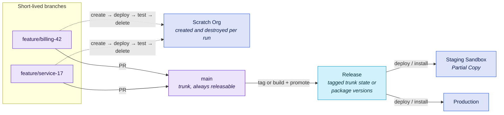

# B3 - Modular Trunk

Several teams on one trunk: `main` is always releasable, work merges daily behind feature flags, and the metadata is cut into modules with explicit dependencies. Fewest long-lived branches of any blueprint here - and the highest bar to entry, set by discipline rather than tooling.

Packaging is a means, not the goal. The goal is modular metadata with explicit dependencies and releasable artifacts. Source modules get you most of the way and are the better default; unlocked packages earn their extra build and promotion cost for stable, shared building blocks.

::: tip In short
For **several teams mature enough to share one trunk**. `main` is always releasable, work merges daily behind feature flags, and the metadata is cut into modules - packages only where a version boundary pays. Switch on a validation check that genuinely blocks, and scratch org CI. **Watch out:** trunk-based without a real gate is just pushing to production.
:::

## At a glance

|                   |                                                                                                     |
| ----------------- | --------------------------------------------------------------------------------------------------- |
| **Team size**     | 8-40+ across several product-aligned teams                                                          |
| **Environments**  | Scratch orgs or developer sandboxes for development and CI + one staging sandbox + production       |
| **Branch model**  | Trunk-based: `main` plus short-lived feature branches, feature-flagged                              |
| **Release style** | Any - continuously, or a tagged state of `main` on a release date                                   |
| **Maturity**      | Level 4 - modular metadata helps, but is not the entry ticket                                       |
| **Prerequisites** | A validation gate that genuinely blocks, a feature-flag convention, and a home for org-level config |

## What you ship

The trunk stays the same; what differs is the artifact you release from it. Pick per module, not once for the whole blueprint - the type of a module can change later.

| Artifact                     | What it is                                                            | Fits                                                                                                   | Watch out for                                                                                    |
| ---------------------------- | --------------------------------------------------------------------- | ------------------------------------------------------------------------------------------------------ | ------------------------------------------------------------------------------------------------ |
| **One source tree**          | The whole source, deployed as a delta from `main`                     | A mature team whose metadata is not modular yet                                                        | Feature flags carry everything; no partial releases                                              |
| **Source modules** (default) | Package directories in `sfdx-project.json`, deployed module by module | Most teams with separable metadata                                                                     | Dependencies are a convention you enforce in review, not something the platform checks           |
| **Unlocked packages**        | Versioned 2GP packages, built, promoted and installed org by org      | Stable building blocks shared across teams or orgs - the shared core in [B4](b4-multi-org-regional.md) | Build and promotion time, 75 % code coverage per package, metadata types that cannot be packaged |

[Org-dependent unlocked packages](https://developer.salesforce.com/docs/platform/sfdx-dev/guide/sfdx-dev-unlocked-pkg-org-dependent.html) are Salesforce's bridge out of a tightly coupled org: they defer dependency validation to install time. They cannot depend on other packages, do not calculate code coverage, and are developed in source-tracked sandboxes rather than scratch orgs - use them for the first cut, not as the end state.

The open-source package toolchain [sfp](https://docs.flxbl.io/libraries/flxbl-framework/techniques/development-practices/choosing-a-package-type) reached the same conclusion: default to source packages, and choose unlocked packages when a specific requirement calls for them.

## Target picture



## Org & sandbox landscape

- **Scratch orgs** carry development and CI. They are created from a definition file, source-tracked, and deleted at the end of every run - so capacity, not entitlement, is the constraint. Work on org-dependent packages, or on metadata that needs real org data, happens in **developer sandboxes** instead.
- **One staging sandbox** (Partial Copy is usually enough) to deploy or install a release into against realistic data before production.
- **Production**, receiving module deployments or package installs - never edits that bypass the trunk.

This blueprint is much lighter on sandbox entitlement than [B2](b2-multi-team-environment-branches.md) - it trades sandbox licences for Dev Hub scratch org capacity and for the engineering effort of modularisation.

## Branch model

- `main` is the trunk and is always releasable.
- Feature branches live hours to a day or two. If a branch cannot merge that fast, the work goes behind a **feature flag** and merges unfinished instead.
- No integration branch, no environment branches. A release is a tagged state of `main` or a promoted package version, not a merge.
- Releasing on dates? Tag `main` on the date - or cut a short-lived release branch from it when a release needs stabilising. Fixes land on `main` first and are cherry-picked into the release branch, never the other way round.

**Feature flags carry the load here.** The common Salesforce implementation is a custom permission per flag (for example prefixed `FF_`), switched on by assigning a permission set - go-live and rollback are an assignment, not a deployment. The simplest version is still valid: do not deploy a component until it is needed. The limit is configuration metadata: a new field or a permission change cannot hide behind a flag, so schema changes stay additive until the feature is live.

## Promotion path & roles

| Role                    | Does                                                                                            |
| ----------------------- | ----------------------------------------------------------------------------------------------- |
| Module team             | Owns one or more modules end to end, including their dependencies and - for packages - versions |
| Developer               | Works in a scratch org, merges to trunk daily, hides incomplete work behind a flag              |
| Release owner           | Tags a release or promotes a package version, and decides where it goes                         |
| Platform / DevOps owner | Owns the Dev Hub, the module dependency graph and the CI configuration                          |

The dependency graph is the thing that needs an owner. Modules that depend on each other must be deployed or installed in order, and nobody notices when that order goes wrong until a release fails in production.

## Strengths

- Teams release independently. No shared release train, so no cross-team blocking.
- Inspectable units of change - you can say exactly which module version is where.
- Almost no merge overhead: one long-lived branch means essentially no XML conflicts between stages.
- Scratch orgs are clean every run, so "works in my sandbox" disappears as a failure class.

## Trade-offs & anti-patterns

- **Cutting out the first module is the real cost.** A mature happy soup does not factor cleanly, and the effort lands on senior people. Budget it as a project, not a sprint task.
- **Something always stays at org level.** Some metadata cannot be packaged at all - check the [Metadata Coverage Report](https://developer.salesforce.com/docs/metadata-coverage) per release - and some belongs to the org rather than to any module. Plan a residual org module from the start.
- **Packages cost build and promotion time.** Every unlocked package version has to be built, needs 75 % code coverage to be promoted, and is installed separately. Use packages where the version boundary pays for itself, not by default.
- **Trunk-based without a real gate is just pushing to production.** The validation check must actually block, and someone must care when trunk goes red.
- **Feature flags accumulate.** Removing a flag is part of finishing a feature. Without that discipline, the flag framework becomes its own legacy system.

## Kit mapping

**Validation as the gate** - [`pr-validation.yml`](/workflows/pr-validation) on every pull request into `main`, as a required check. With source modules or one source tree, this is the gate that keeps trunk releasable.

**Scratch org CI for modules** - [`scratch-org-ci.yml`](/workflows/scratch-org-ci) on every pull request. It creates a clean org, installs dependency packages, deploys, runs tests and always deletes the org again - which proves a module builds on its declared dependencies alone:

```yaml
name: Scratch Org CI

on:
  pull_request:
    branches: [main]

permissions:
  contents: read

jobs:
  ci:
    uses: svierk/salesforce-devops-starter-kit/.github/workflows/scratch-org-ci.yml@v1.7.1
    with:
      source-dir: force-app
      definition-file: config/project-scratch-def.json
      duration-days: '1'
      test-level: RunLocalTests
      # Dependency packages this one builds on, in install order
      packages: '04t...'
    secrets:
      SFDX_CONSUMER_KEY: ${{ secrets.SFDX_CONSUMER_KEY }}
      SFDX_JWT_SECRET_KEY: ${{ secrets.SFDX_JWT_SECRET_KEY }}
      SFDX_USERNAME: ${{ secrets.SFDX_USERNAME }}
```

**Releasing source** - [`deployment.yml`](/workflows/deployment) on push to `main` (continuous) or on a release tag (release dates), with `delta: true` and `delta-from` set to the previous release, behind a `production` GitHub Environment exactly as in [B1](b1-simple-org-development.md).

**Installing package versions** - the [`sfdx-package-installation`](https://github.com/svierk/sfdx-package-installation) building block, in a job gated by the same environment:

```yaml
- name: Install package version
  uses: svierk/sfdx-package-installation@v1.3.0
  with:
    packages: '04t...'
    target-org: production
```

::: warning Package version creation is not yet a building block
The kit does not ship an action for `sf package version create` / `promote` yet. Until it does, that step is a plain `sf` CLI call in your own workflow - the CLI is already installed by [`sfdx-cli-setup`](https://github.com/svierk/sfdx-cli-setup) and authenticated by [`sfdx-login`](https://github.com/svierk/sfdx-login), so it is a few lines rather than a gap in the pipeline.
:::

**Developer self-service** - [`create-scratch-org.yml`](/workflows/create-scratch-org) matters more here than anywhere else. Developers need orgs constantly, and a `workflow_dispatch` caller means they get one with packages installed, source deployed, data imported and a password generated, without a local CLI.

**Branch protection on `main`:**

- Require a pull request, with review from the owning module team
- Require both the scratch org CI and the validation checks to pass
- Require branches to be up to date before merging
- Block force pushes and deletions

## Migration path

**From here, the changes are usually organisational rather than structural.** More modules, clearer ownership boundaries, tighter dependency management. Moving a module from source to an unlocked package - or back - is a decision per module, not a change of blueprint.

**To [B4](b4-multi-org-regional.md)** if a second production org appears. B3 makes that transition easy - modules, and packages in particular, are already the unit of distribution that a multi-org rollout needs.

**Signals you over-built:** modules or packages that always release together (merge them), a dependency graph nobody can draw, or more time spent on package plumbing than on the features inside. Fewer, larger modules is a valid correction.
