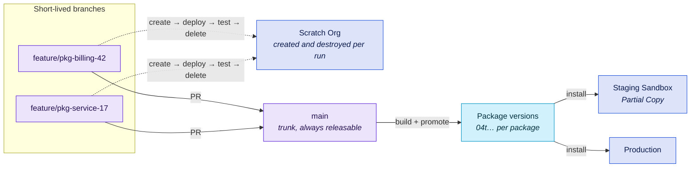

# B3 - Package-Based / Modular

Metadata split into versioned unlocked packages, developed against scratch orgs, released on independent schedules. Fewest long-lived branches of any blueprint here - and the highest bar to entry.

## At a glance

|                   |                                                                                  |
| ----------------- | -------------------------------------------------------------------------------- |
| **Team size**     | 8-40+ across several product-aligned teams                                       |
| **Environments**  | Scratch orgs for development and CI + one or two sandboxes + production          |
| **Branch model**  | Trunk-based: `main` plus short-lived feature branches, feature-flagged           |
| **Cadence**       | Continuous, per package                                                          |
| **Maturity**      | Level 3-4                                                                        |
| **Prerequisites** | Dev Hub with scratch org capacity, metadata that genuinely factors into packages |

## Target picture



## Org & sandbox landscape

- **Scratch orgs** carry development and CI. They are created from a definition file, source-tracked, and deleted at the end of every run - so capacity, not entitlement, is the constraint.
- **One staging sandbox** (Partial Copy is usually enough) to install package versions into against realistic data before production.
- **Production**, receiving package installs rather than metadata deployments.

This blueprint is much lighter on sandbox entitlement than [B2](b2-multi-team-environment-branches.md) - it trades sandbox licences for Dev Hub scratch org capacity and for the engineering effort of packaging.

## Branch model

- `main` is the trunk and is always releasable.
- Feature branches live hours to a day or two. If a branch cannot merge that fast, the work goes behind a **feature flag** and merges unfinished instead.
- No integration branch, no release branches. Release is a package version promotion, not a merge.
- Package versions are the unit of release, so `main` can move continuously while each package ships on its own schedule.

**Feature flags carry the load here.** Custom permissions plus custom metadata types is the common implementation. The simplest version is still valid: do not deploy a component until it is needed. Whatever you choose, flags are what make short-lived branches possible - without them, trunk-based development becomes "ship half-built features".

## Promotion path & roles

| Role                    | Does                                                                               |
| ----------------------- | ---------------------------------------------------------------------------------- |
| Package team            | Owns one or more packages end to end, including their version history              |
| Developer               | Works in a scratch org, merges to trunk daily, hides incomplete work behind a flag |
| Release owner           | Promotes a package version and decides where it installs                           |
| Platform / DevOps owner | Owns the Dev Hub, the package dependency graph and the CI configuration            |

The dependency graph is the thing that needs an owner. Packages that depend on each other must be built and installed in order, and nobody notices when that order goes wrong until an install fails in production.

## Strengths

- Teams release independently. No shared release train, so no cross-team blocking.
- Versioned, inspectable units of change - you can say exactly what is installed where.
- Almost no merge overhead: one long-lived branch means essentially no XML conflicts between stages.
- Scratch orgs are clean every run, so "works in my sandbox" disappears as a failure class.

## Trade-offs & anti-patterns

- **Extracting the first package is the real cost.** A mature happy soup does not factor cleanly, and the effort lands on senior people. Budget it as a project, not a sprint task.
- **Not all metadata is packageable.** Check the [Metadata Coverage Report](https://developer.salesforce.com/docs/metadata-coverage) per release. Something unpackageable always remains, so plan for a residual "org" package or a small metadata deployment alongside the packages.
- **Dependency validation bites.** Org-dependent unlocked packages (`--org-dependent`) resolve build-time "field does not exist" failures by deferring validation to install time - but you lose "build once, install anywhere". Use deliberately, not as a default escape hatch.
- **Trunk-based without a real gate is just pushing to production.** The validation check must actually block, and someone must care when trunk goes red.
- **Feature flags accumulate.** Removing a flag is part of finishing a feature. Without that discipline, the flag framework becomes its own legacy system.

## Kit mapping

::: warning Packaging itself is not yet a building block
This kit covers scratch org lifecycle, deployment, testing and package **installation** ([`sfdx-package-installation`](https://github.com/svierk/sfdx-package-installation)). It does not yet ship an action for `sf package version create` / `promote`. Until it does, that step is a plain `sf` CLI call in your own workflow - the CLI is already installed by [`sfdx-cli-setup`](https://github.com/svierk/sfdx-cli-setup) and authenticated by [`sfdx-login`](https://github.com/svierk/sfdx-login), so it is a few lines rather than a gap in the pipeline.
:::

**Scratch org CI as the primary gate** - [`scratch-org-ci.yml`](/workflows/scratch-org-ci) on every pull request. It creates a clean org, installs dependency packages, deploys, runs tests and always deletes the org again:

```yaml
name: Scratch Org CI

on:
  pull_request:
    branches: [main]

permissions:
  contents: read

jobs:
  ci:
    uses: svierk/salesforce-devops-starter-kit/.github/workflows/scratch-org-ci.yml@v1.1.0
    with:
      source-dir: force-app
      definition-file: config/project-scratch-def.json
      duration-days: '1'
      test-level: RunLocalTests
      # Dependency packages this one builds on, in install order
      packages: '04t...'
    secrets:
      SFDX_CONSUMER_KEY: ${{ secrets.SFDX_CONSUMER_KEY }}
      SFDX_JWT_SECRET_KEY: ${{ secrets.SFDX_JWT_SECRET_KEY }}
      SFDX_USERNAME: ${{ secrets.SFDX_USERNAME }}
```

Add [`pr-validation.yml`](/workflows/pr-validation) alongside it with `delta: true` for the fast static-analysis feedback loop - it returns long before the scratch org run finishes.

**Installing a promoted version** - [`deployment.yml`](/workflows/deployment) handles the residual unpackaged metadata; the package install itself uses the building block directly:

```yaml
- name: Install package version
  uses: svierk/sfdx-package-installation@v1.3.0
  with:
    packages: '04t...'
    target-org: production
```

Gate that job with a GitHub Environment (`environment: production`, required reviewers) exactly as in [B1](b1-simple-org-development.md).

**Developer self-service** - [`create-scratch-org.yml`](/workflows/create-scratch-org) matters more here than anywhere else. Developers need orgs constantly, and a `workflow_dispatch` caller means they get one with packages installed, source deployed, data imported and a password generated, without a local CLI.

**Branch protection on `main`:**

- Require a pull request, with review from the owning package team
- Require both the scratch org CI and the validation checks to pass
- Require branches to be up to date before merging
- Block force pushes and deletions

## Migration path

**From here, the changes are usually organisational rather than structural.** More packages, clearer ownership boundaries, tighter dependency management.

**To [B4](b4-multi-org-regional.md)** if a second production org appears. B3 makes that transition easy - packages are already the unit of distribution, which is exactly what a multi-org rollout needs.

**Signals you over-built:** packages that always release together (merge them), a dependency graph nobody can draw, or more time spent on package plumbing than on the features inside. Fewer, larger packages is a valid correction.
