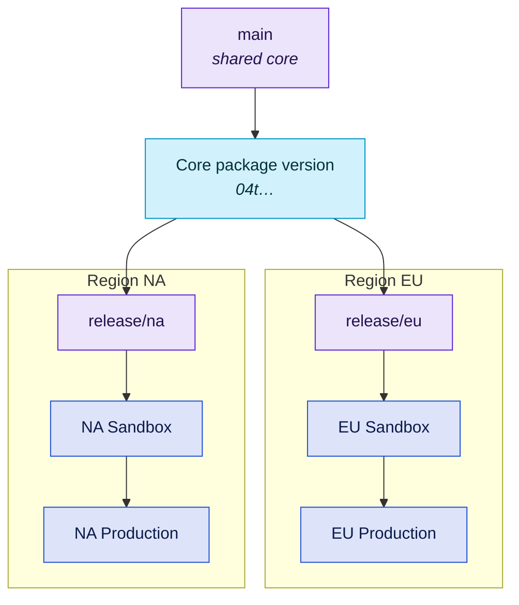

# B4 - Multi-Org / Regional Rollout

Several production orgs - by region, business unit or brand - with a shared core that is maintained once while local differences stay local.

Two shapes work. The default below is **a trunk with a packaged core**: one repository, the core released as package versions, each org adopting them on its own schedule. The alternative is **[per-org environment chains](#per-org-environment-chains)**: one repository per org, each running [B2](b2-multi-team-environment-branches.md), with the shared metadata in a repository of its own.

::: tip In short
For **several production orgs** - by region, business unit or brand. Maintain the shared core once and keep local differences local: either one trunk with the core as modules or packages, or one repository per org running [B2](b2-multi-team-environment-branches.md) plus a shared-metadata repository. **Watch out:** orgs drift apart by default - review local exceptions as strictly as the core.
:::

## At a glance

|                   |                                                                                                    |
| ----------------- | -------------------------------------------------------------------------------------------------- |
| **Team size**     | 10-50+, usually a core team plus local teams                                                       |
| **Environments**  | One sandbox chain per production org, plus shared scratch orgs                                     |
| **Branch model**  | Trunk plus one short release branch per org rollout - or a B2 chain per org                        |
| **Cadence**       | Core releases continuously; each org adopts on its own schedule                                    |
| **Maturity**      | Level 3-4 for the trunk shape; per-org chains work from level 2-3                                  |
| **Prerequisites** | A packaged core, or a defined way to share common metadata; sandbox entitlement per production org |

## Target picture



## Org & sandbox landscape

- **One production org per region or business unit.** That is the definition of this blueprint.
- **One sandbox chain per production org** - at minimum a UAT-grade sandbox each, because local data and local configuration are exactly what you are validating.
- **Shared scratch orgs** for core development.

The sandbox cost scales with the number of orgs, and so does everything else: secrets, environments, deployment runs, on-call. Confirm that multi-org is a business requirement (data residency, compliance, genuinely divergent processes) and not the residue of an acquisition nobody has consolidated. See [Background](background.md#single-org-vs-multi-org).

## Repository topology

Two workable shapes:

|                              | Monorepo (recommended)                               | Multi-repo                                                                                                               |
| ---------------------------- | ---------------------------------------------------- | ------------------------------------------------------------------------------------------------------------------------ |
| Layout                       | One repo: `packages/core` + `orgs/<region>` overlays | One repo per org, plus a shared repo for common metadata - consumed as a package or deployed alongside each org's source |
| Core change reaches all orgs | Atomically, in one pull request                      | Via a version bump per repo                                                                                              |
| Local team autonomy          | Lower - shared CI, shared review                     | Higher - own repo, own cadence                                                                                           |
| Fits                         | Strong shared core, central platform team            | Autonomous orgs with their own teams; the home of per-org environment chains                                             |

Start with the monorepo if one platform team owns the core. Splitting later is mechanical; merging back is not. Choose multi-repo from the start when each org already has its own team and its own release rhythm.

Structure the source so that "shared" and "local" are unambiguous:

```
packages/
  core/                  # the shared package - source of truth for common metadata
orgs/
  eu/                    # EU-only metadata and overrides
  na/                    # NA-only metadata and overrides
config/
  scratch-def-core.json
```

## Branch model

- `main` is the trunk for the core, exactly as in [B3](b3-modular-trunk.md).
- `release/<org>` branches are **short-lived** - created for a rollout, merged or deleted after it lands. They exist to pin the core version an org is adopting and to carry rollout-specific fixes.
- Org-local metadata under `orgs/<region>/` changes on `main` too. It is scoped by path, not by branch.

**The anti-pattern to avoid:** a permanent long-lived branch per production org _inside one repository_. That is [branch-per-org](background.md#branching-models) at organisational scale, and it guarantees that the regions diverge until the shared core is a fiction. Version pinning through packages is what keeps orgs independent - not branches.

### Per-org environment chains

When each org has its own team, its own sandbox chain and its own approval process, run [B2](b2-multi-team-environment-branches.md) **once per org, in that org's own repository** - with whichever of its three variants fits how that org releases. The orgs stay independent the way separate repositories are independent, not through branches.

What remains shared is the common metadata. Keep it in its own repository with its own review, and decide once how it reaches the orgs: as a package version each org pins, or as source deployed together with each org's metadata. Either way, a change to shared metadata is a change to every org - validate it against each of them before it lands.

## Promotion path & roles

| Role                     | Does                                                               |
| ------------------------ | ------------------------------------------------------------------ |
| Core / platform team     | Owns `packages/core`, its versions and the rollout calendar        |
| Regional lead            | Owns `orgs/<region>`, decides when their org adopts a core version |
| Regional release manager | Runs the rollout for one org, owns its production approval         |

The key contract: **the core team decides what is released; regional teams decide when they adopt it.** Write that down, because the failure mode is the core team being held responsible for a region's timeline.

Set a maximum version lag - "no org may be more than two core versions behind". Without it, the oldest org silently becomes unsupportable.

## Strengths

- Regions get autonomy over their release timing without forking the codebase.
- The shared core is built and tested once, then installed many times.
- Compliance and data-residency boundaries are respected by construction.
- Adding a region is a configuration change, not an architectural one.

## Trade-offs & anti-patterns

- **Everything multiplies.** Pipelines, secrets, environments, test matrices, incidents. The per-org cost is roughly linear - budget for it.
- **Divergence is the default outcome.** Every local exception is reasonable in isolation and corrosive in aggregate. Review what goes into `orgs/<region>/` as strictly as you review the core.
- **Cross-org reporting is somebody's problem.** This blueprint does not solve it; it makes it harder. Data platform work usually follows.
- **A change failing in region three of five** leaves you partially rolled out with no rollback. Decide in advance whether you pause the rollout or fix forward.
- **Size each org's chain to its own approval process.** Full four-stage chains per org work when each org has a team and a repository of its own. Run centrally by one team, five of them are unmanageable - then keep each chain to one sandbox plus production.

## Kit mapping

The callers below are for the trunk shape. **With per-org environment chains**, each org's repository uses the [B2 callers](b2-multi-team-environment-branches.md#kit-mapping) unchanged - the multi-org part is the shared metadata, not the pipeline.

**Fan out with a matrix.** One caller deploys to every org, with a GitHub Environment per org carrying that org's credentials and approval rules:

```yaml
name: Regional Rollout

on:
  workflow_dispatch:
    inputs:
      region:
        description: Region to roll out to (or "all")
        type: choice
        options: [all, eu, na, apac]

permissions:
  contents: read

jobs:
  rollout:
    strategy:
      # Never cancel the remaining orgs because one failed - a partial rollout
      # needs a deliberate decision, not an automatic abort.
      fail-fast: false
      # Roll out one org at a time so a failure can be caught before it spreads.
      max-parallel: 1
      matrix:
        # "all" fans out to every org; a single region rolls out on its own
        region: ${{ fromJSON(inputs.region == 'all' && '["eu","na","apac"]' || format('["{0}"]', inputs.region)) }}
    uses: svierk/salesforce-devops-starter-kit/.github/workflows/deployment.yml@v1.1.0
    with:
      source-dir: orgs/${{ matrix.region }}
      target-org-alias: ${{ matrix.region }}-production
      test-level: RunLocalTests
      environment: ${{ matrix.region }}-production # own secrets + own reviewers
    secrets: inherit
```

::: tip One GitHub Environment per production org
Store each org's `SFDX_CONSUMER_KEY`, `SFDX_JWT_SECRET_KEY` and `SFDX_USERNAME` as environment secrets and add that region's release manager as a required reviewer. `secrets: inherit` then resolves the right org per matrix leg, and no credential is ever visible to another region's job.
:::

**Validate against every affected org.** A core change touches all of them, and a check-only delta deployment into each org's sandbox catches the region whose local configuration conflicts with the core change - the failure this blueprint exists to survive. [`pr-validation.yml`](/workflows/pr-validation) does not run inside a GitHub Environment, so it cannot pick up per-org environment secrets: add one validation job per region and pass that region's sandbox credentials explicitly through its `secrets:` block.

**Distribute the core with** [`sfdx-package-installation`](https://github.com/svierk/sfdx-package-installation), pinning an explicit version per org rather than "latest". The pin is what makes independent adoption real.

**Path-filter the CI.** A change under `orgs/eu/` should not trigger validation for NA and APAC. Use `paths:` on the caller workflows - without it, every pull request runs the full matrix and the feedback loop becomes unusable.

**Branch protection on `main`:** as [B3](b3-modular-trunk.md), plus [`CODEOWNERS`](https://docs.github.com/en/repositories/managing-your-repositorys-settings-and-features/customizing-your-repository/about-code-owners) mapping `packages/core/` to the core team and each `orgs/<region>/` to its regional team. In a monorepo, CODEOWNERS is what makes ownership boundaries real.

## Migration path

**This is usually a terminal state** - you arrive here because of business structure, and you leave only if that structure changes.

**Toward consolidation:** if the regions' processes converge, the honest move is to merge orgs and drop back to [B3](b3-modular-trunk.md). Watch for it - "we keep the orgs separate because we always have" is worth challenging every couple of years.

**Signals of trouble:** an org more than two core versions behind, `orgs/<region>/` growing faster than `packages/core/`, or rollouts that routinely stop halfway. Each means the shared core is losing to local divergence.
