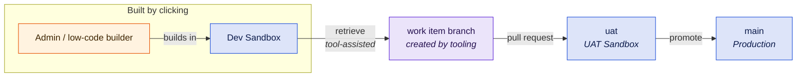

# B5 - Low-Code First

Most changes are built by clicking, by people who do not use Git. The strategy's job here is to make version control real without making it the admins' problem.

::: tip In short
For **admin-heavy teams** where Git knowledge is the bottleneck. Two org-bound branches, `uat` and `main`, with tooling such as DevOps Center doing the promoting and a static-analysis gate tuned to declarative work. Admins never have to touch Git. **Watch out:** the bus factor - name a pipeline owner and a deputy.
:::

## At a glance

|                   |                                                                          |
| ----------------- | ------------------------------------------------------------------------ |
| **Team size**     | 2-10, mostly admins and low-code builders                                |
| **Environments**  | Shared dev sandbox + UAT + production                                    |
| **Branch model**  | Simplified environment branches, driven by tooling rather than by hand   |
| **Cadence**       | Mixed - regular small releases plus ad-hoc changes                       |
| **Maturity**      | Level 1-2                                                                |
| **Prerequisites** | One person who owns the pipeline; the rest of the team never touches Git |

## Target picture



## Org & sandbox landscape

- **One shared Developer sandbox** where admins build. Shared, because coordinating one org is easier for this team than owning one each.
- **One UAT sandbox** (Partial Copy if the budget allows - business users testing against empty objects will not find the bugs that matter).
- **Production.**

Three environments is the ceiling here, not a starting point. Every additional stage is one more place where someone has to understand what a merge is.

## Branch model

Two long-lived branches, `uat` and `main`, each bound to an org. Work-item branches are created **by tooling**, not by hand:

- Salesforce **DevOps Center** creates a branch per work item and promotes through a UI. This is the on-ramp it was built for.
- Or a `workflow_dispatch` workflow in this repository that retrieves named metadata from the dev sandbox and opens the pull request - a "retrieve my change" button in the Actions tab.

Either way, the admin's interface is a form, not a command line.

::: warning Two stages, deliberately
This is an environment-branch model, which [Background](background.md#branching-models) warns about - and the warning holds. It is defensible here only because there are **two** stages, not four, and because tooling performs the promotions. If you find yourself adding a third org-bound branch, the model has outgrown its justification: move to [B1](b1-simple-org-development.md) if the team has learned Git, or to [B2](b2-multi-team-environment-branches.md) if you genuinely need the gates.
:::

## Promotion path & roles

| Role                     | Does                                                                                      |
| ------------------------ | ----------------------------------------------------------------------------------------- |
| Admin / low-code builder | Builds in the shared dev sandbox, requests a retrieve, tests in UAT. Never touches Git    |
| Pipeline owner           | Owns the workflows, reviews every pull request, resolves the conflicts. The critical role |
| Business owner           | Signs off in UAT                                                                          |

**The pipeline owner is the single point of failure.** One person understanding the repository is the defining risk of this blueprint. Mitigate it: document the promotion procedure as a runbook, make sure a second person can run it, and treat "the pipeline owner is on holiday" as a scenario to rehearse rather than discover.

## Working agreements

Process carries more weight here than tooling. Three agreements that decide whether this blueprint works:

1. **Nothing is built directly in production.** No exceptions - a change made in production is a change the pipeline will overwrite.
2. **The shared dev sandbox is claimed before it is used.** A message in a channel is enough. Two admins editing the same flow in one org produces a conflict nobody can resolve from the XML.
3. **Retrieve promptly.** A change built three weeks ago and never retrieved is lost the next time the sandbox is refreshed.

## Strengths

- Admins keep working the way they already work.
- Real version control and an audit trail, without retraining the team.
- Only two stages, so the merge overhead is modest.
- A genuine step up from change sets, with a low adoption cost.

## Trade-offs & anti-patterns

- **The bus factor is one.** See above. This is the trade-off you are accepting.
- **Retrieval is the weak link.** If someone forgets, the change exists only in a sandbox. Automate the reminder, or run a scheduled diff against the org.
- **Flow and profile conflicts still land on the pipeline owner.** Prefer permission sets over profiles from day one - it removes the single worst conflict source.
- **DevOps Center has real limits:** no rollback, org-based development rather than scratch orgs and packages, its own work items rather than your issue tracker, and it copes poorly with merges made outside the tool. Its quality gates (tests, coverage, Code Analyzer) now cover part of what the kit's validation does - but only for changes that go through DevOps Center. Treat it as an on-ramp, not the destination.
- **Do not add stages to buy confidence.** Confidence comes from the validation gate and the UAT sign-off, not from a third sandbox.

## Kit mapping

**Validation, tuned down.** [`pr-validation.yml`](/workflows/pr-validation) still runs on every pull request, but the static analysis threshold is relaxed - declarative metadata trips analyzer rules written for Apex, and a gate that blocks constantly for reasons nobody in the team can act on will be switched off within a month:

```yaml
name: PR Validation

on:
  pull_request:
    branches: [uat, main]

permissions:
  contents: read
  security-events: write

jobs:
  validate:
    uses: svierk/salesforce-devops-starter-kit/.github/workflows/pr-validation.yml@v1.1.0
    with:
      source-dir: force-app
      delta: true
      run-code-review: true
      severity-threshold: '2' # only high-severity findings block
      test-level: RunLocalTests
    secrets: inherit
```

Start at `severity-threshold: '2'` and tighten it as the team's Apex share grows.

`secrets: inherit` hands the validation the repository secrets - store the UAT sandbox credentials there. The environment secrets below only reach the deployments.

::: warning One deployment engine per stage
DevOps Center deploys when it promotes a work item, and it merges into `uat` and `main` as it does so. If DevOps Center is your promotion tool, do **not** add the deployment caller below as well - every promotion would deploy twice, the second time outside DevOps Center's view. Let DevOps Center own deployment, keep the kit for validation and self-service orgs, and check that your branch protection rules still allow DevOps Center's merges.
:::

**Deployment per stage** - only on the kit route, where a workflow in this repository opens the work-item pull requests: [`deployment.yml`](/workflows/deployment) on push to `uat` and `main`, with a GitHub Environment each:

```yaml
name: Deployment

on:
  push:
    branches: [uat, main]

permissions:
  contents: read

jobs:
  deploy:
    uses: svierk/salesforce-devops-starter-kit/.github/workflows/deployment.yml@v1.1.0
    with:
      source-dir: force-app
      target-org-alias: ${{ github.ref_name }}
      test-level: RunLocalTests
      environment: ${{ github.ref_name == 'main' && 'production' || 'uat' }}
    secrets: inherit
```

Add required reviewers to the `production` environment. That approval is the release decision, and it is the one moment a human must be in the loop.

**Self-service org provisioning** - [`create-scratch-org.yml`](/workflows/create-scratch-org) as a `workflow_dispatch` caller gives an admin a fully configured org from a form in the Actions tab, with data imported and a password generated. No CLI, no Dev Hub knowledge. This is the highest-value optional piece for this audience.

**Branch protection on `uat` and `main`:**

- Require a pull request before merging
- Require the PR Validation check to pass
- Require review from the pipeline owner
- Block force pushes and deletions
- Keep `uat` as the default branch, so tooling targets it by default

## Migration path

**To [B1](b1-simple-org-development.md)** once enough of the team is comfortable with pull requests. Collapsing `uat` into a deployment gate on `main` removes a whole branch and its merge overhead - this is a simplification, and the most common next step.

**To [B2](b2-multi-team-environment-branches.md)** only if a second stream and a formal approval process appear together. Do not go there for the environments alone.

**Signals you are ready to move:** admins opening their own pull requests, the pipeline owner no longer being the only one who resolves conflicts, and a growing share of pro-code work.

**Signals of strain:** retrieves being forgotten, the shared dev sandbox being contended, or the pipeline owner as a permanent queue. The first two are process problems; the third means it is time for a second pipeline owner, not a new branching model.
