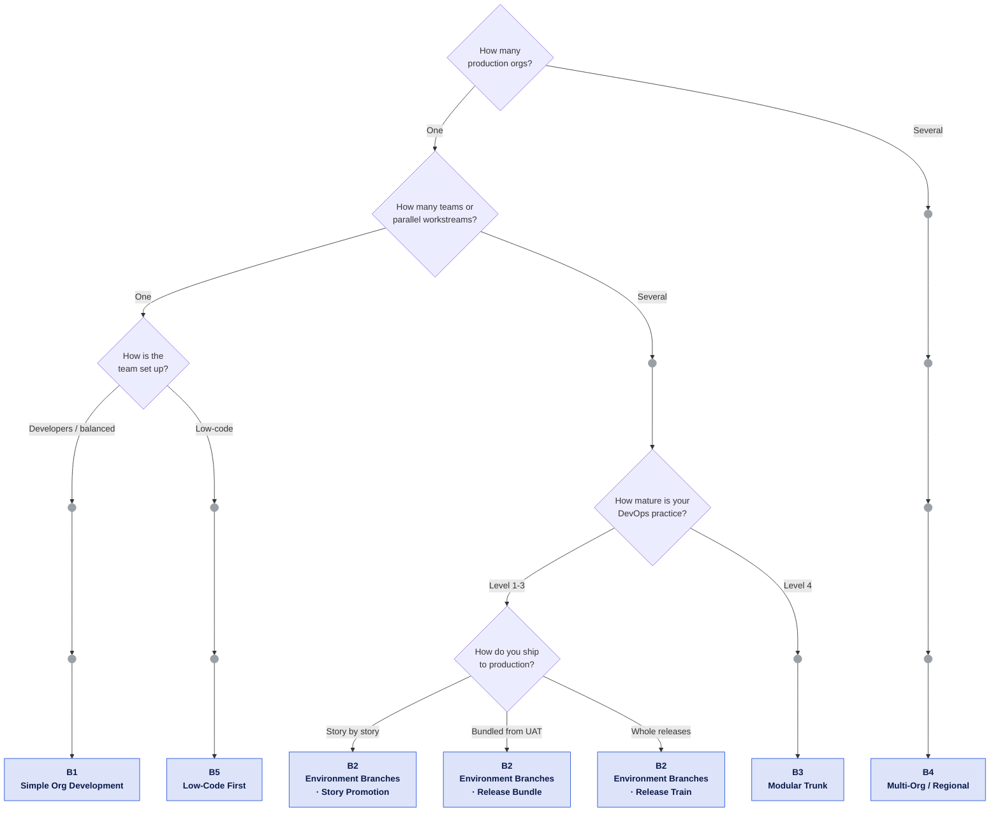

# Find your blueprint

Answer a handful of questions about your org landscape, your team and how you release. You get one of five blueprints - a concrete target picture with the workflows, environments and branch protection rules of this kit to switch on. The **?** next to each question explains why it matters.

<ClientOnly>
  <StrategyWizard />
</ClientOnly>

::: tip Not a commitment
A blueprint is a starting point, not an identity. Every blueprint page ends with a **migration path** and the signals that tell you it is time to move. If two answers feel equally true, take the simpler one - adding a long-lived branch later is far cheaper than unwinding one.
:::

## The five blueprints

| Blueprint                                                                            | Fits when                                          | Branch model                                                                         |
| ------------------------------------------------------------------------------------ | -------------------------------------------------- | ------------------------------------------------------------------------------------ |
| [**B1** Simple Org Development](b1-simple-org-development.md)                        | One team, one production org                       | GitHub Flow: `main` + short-lived `feature/*`                                        |
| [**B2** Multi-Team with Environment Branches](b2-multi-team-environment-branches.md) | Several teams, one production org, approval gates  | One branch per org - stories promoted one by one, as a bundle, or as a release train |
| [**B3** Modular Trunk](b3-modular-trunk.md)                                          | Several teams on one trunk, maturity level 4       | Trunk-based with feature flags; modules or packages as artifacts                     |
| [**B4** Multi-Org / Regional Rollout](b4-multi-org-regional.md)                      | Several production orgs by region or business unit | Trunk with a shared core, or a B2 chain per org                                      |
| [**B5** Low-Code First](b5-low-code-admin-first.md)                                  | Admin-heavy team, Git knowledge is the bottleneck  | Two org-bound branches, tool-driven promotion                                        |

Every blueprint page opens with an **In short** box, so you can compare them in a minute. [Kit Mapping](mapping.md) puts their configuration side by side; [Background & Trade-Offs](background.md) holds the reasoning - sandbox licences, org vs. package development, branching models, release styles and maturity signals.

## How the routing works

The questions, the decision tree and every path at a glance

The questionnaire always asks the same five questions in this order, so every path through the tree has the same length. Where an answer cannot change the blueprint, the path runs through a small dot - the answer still tailors the result.

1. **How many production orgs do you run?** One · Several
2. **How many teams or parallel workstreams?** One · Several
3. **How is the team set up?** Mostly developers · Balanced, cross-functional · Mostly admins and low-code builders
4. **How mature is your DevOps practice?** Level 1 - starting out · Level 2-3 - established · Level 4 - advanced
5. **How do you ship to production?** Story by story · Story by story to UAT, bundled into production · Whole releases on planned dates

| Your answers (questions 1-5)                            | Blueprint                                                    |
| ------------------------------------------------------- | ------------------------------------------------------------ |
| Several orgs · any · any · level 1-3 · any              | [B4](b4-multi-org-regional.md), per-org environment chains   |
| Several orgs · any · any · level 4 · any                | [B4](b4-multi-org-regional.md), trunk with a shared core     |
| One org · one team · developers or balanced · any · any | [B1](b1-simple-org-development.md)                           |
| One org · one team · admins · any · any                 | [B5](b5-low-code-admin-first.md)                             |
| One org · several · any · level 1-3 · story by story    | [B2](b2-multi-team-environment-branches.md), story promotion |
| One org · several · any · level 1-3 · bundled           | [B2](b2-multi-team-environment-branches.md), release bundle  |
| One org · several · any · level 1-3 · whole releases    | [B2](b2-multi-team-environment-branches.md), release train   |
| One org · several · any · level 4 · any                 | [B3](b3-modular-trunk.md)                                    |

At level 1, B2 starts with two stages. Several teams of admins keep their blueprint, but let tooling do the promoting.

The routing is a heuristic, not a measurement: there is no neutral, Salesforce-specific data that ties a branching model to delivery performance. The blueprints are for teams building on their own production orgs - if you distribute an app through AppExchange, you need managed 2GP packages and a namespace, and none of them is your model.

