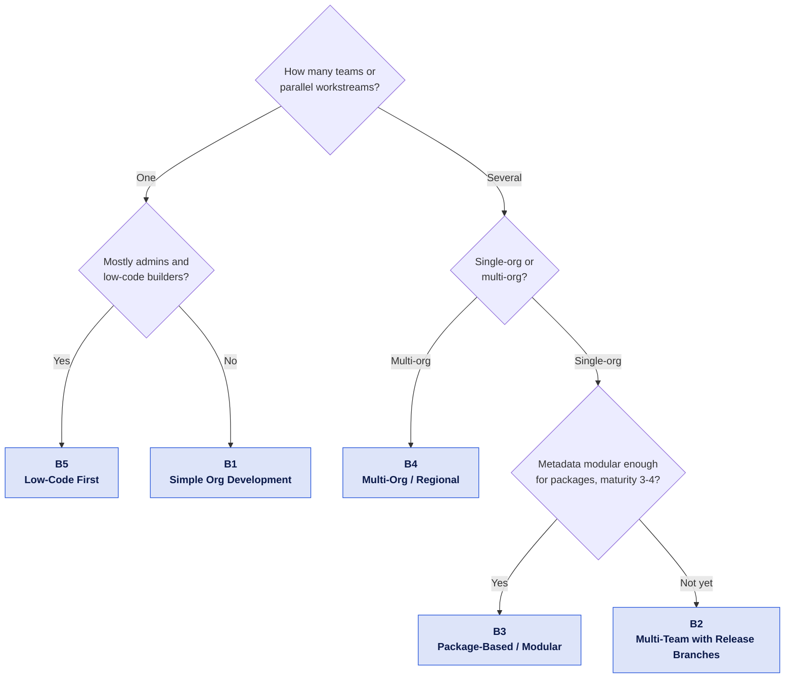

# Org & Branching Strategy

The rest of this kit answers _how_ to run a pipeline. This section answers the question that comes first: **which** org landscape and branching model should you run it on?

Salesforce makes that choice harder than it is elsewhere. Sandboxes are licensed, metered and slow to refresh; there is no true rollback; declarative changes arrive from people who may never touch Git; and XML metadata merges badly. Copying a branching model from a web project rarely survives contact with those constraints.

So this section does three things:

1. Asks you a few questions about your team and your org landscape.
2. Points you at one of **five blueprints** - concrete, opinionated target pictures.
3. Tells you, per blueprint, [exactly which workflows, actions and branch protection rules](mapping.md) of this kit to switch on.

::: tip Not a commitment
A blueprint is a starting point, not an identity. Every blueprint page ends with a **migration path** to the next one, and with the signals that tell you it is time to move.
:::

## Find your blueprint

Three to five questions, one at a time - the questionnaire only asks what can still change your answer. Your path lights up in the decision tree as you go, and the result carries a link you can paste into a ticket.

<ClientOnly>
  <StrategyWizard />
</ClientOnly>

Prefer to read the tree yourself?

The questionnaire above is interactive on the [documentation site](https://svierk.github.io/salesforce-devops-starter-kit/strategy/); this is the same decision tree as a static diagram. [The Five Questions](questions.md) explains why each one is asked and what it changes.

::: info If two paths feel equally true
Take the simpler one. Adding a long-lived branch later is far cheaper than unwinding one.
:::

## The five blueprints

| Blueprint                                                                    | Fits when                                                | Org landscape                              | Branch model                                 |
| ---------------------------------------------------------------------------- | -------------------------------------------------------- | ------------------------------------------ | -------------------------------------------- |
| [**B1** Simple Org Development](b1-simple-org-development.md)                | One team, one production org, getting started            | 1 developer sandbox + production           | GitHub Flow (`main` + `feature/*`)           |
| [**B2** Multi-Team with Release Branches](b2-multi-team-release-branches.md) | Several streams, fixed release trains, approval gates    | Integration + UAT + PreProd + production   | Promotion chain of major branches            |
| [**B3** Package-Based / Modular](b3-package-based-modular.md)                | Modularised metadata, high maturity, continuous delivery | Scratch orgs + few sandboxes               | Trunk-based + short-lived feature branches   |
| [**B4** Multi-Org / Regional Rollout](b4-multi-org-regional.md)              | Several production orgs by region or business unit       | One org per region/BU, shared core package | Trunk + per-org release branches             |
| [**B5** Low-Code First](b5-low-code-admin-first.md)                          | Admin-heavy team, Git knowledge is the bottleneck        | Dev + UAT + production, heavy automation   | Simplified environment branches, tool-driven |

## How to read a blueprint page

Every blueprint documents the same eight things, so you can diff them against each other:

- **At a glance** - team size, environments, cadence, prerequisites
- **Target picture** - a diagram of branches and the orgs they deploy to
- **Org & sandbox landscape** - which sandbox types, and what they cost you in licences
- **Branch model** - branch names, lifetimes and merge direction
- **Promotion path & roles** - who moves what, and through which gate
- **Strengths / Trade-offs & anti-patterns** - honest, including what this model is bad at
- **Kit mapping** - the workflows, actions and branch protection rules to switch on
- **Migration path** - the next blueprint, and the signals that you are ready for it

## Background

If you want the reasoning rather than the recommendation, [Dimensions & Trade-Offs](dimensions.md) covers sandbox types and licence bundles, org development vs. package development, the common branching models and the maturity signals (DORA) used throughout this section.
